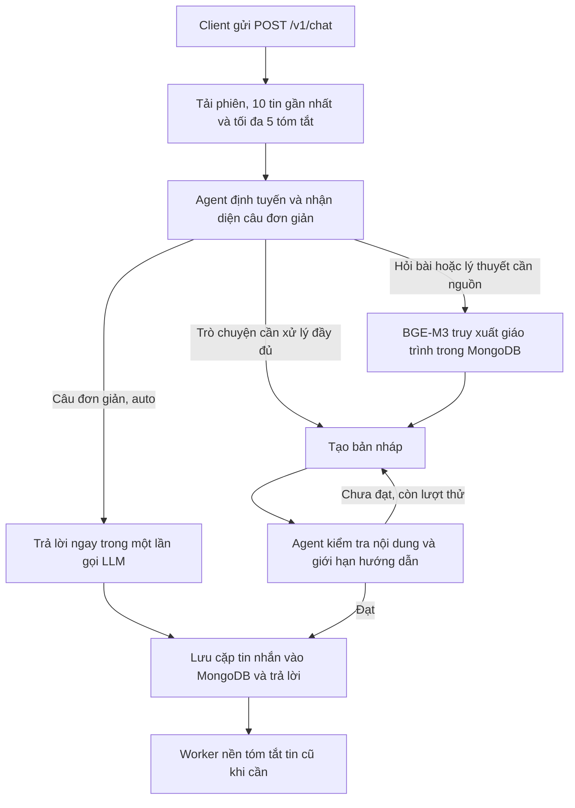

# MAS — API trợ giảng lý thuyết đồ thị

MAS là dịch vụ FastAPI cho ứng dụng học lý thuyết đồ thị. Client gửi tin nhắn tới `/v1/chat`; hệ thống chọn cách trả lời theo mục đích của người học, lưu hội thoại trong MongoDB và dùng giáo trình đã đánh chỉ mục khi cần. Mặc định dự án dùng Qwen qua proxy tương thích OpenAI; cũng có cấu hình cho OpenAI và Gemini.

| Loại yêu cầu | Cách phản hồi |
| --- | --- |
| Trò chuyện (`conversation`) | Trả lời tự nhiên, có dùng ngữ cảnh phiên. |
| Hỏi bài (`tutoring`) | Gợi ý phương pháp và bước tiếp theo để người học tự làm; không đưa đáp án cuối, lời giải hoàn chỉnh hoặc xác nhận đáp án được đề xuất. |
| Hỏi lý thuyết (`knowledge`) | Tìm đoạn liên quan trong giáo trình, giải thích khái niệm và dẫn nguồn. |

## Luồng xử lý



Phần kiểm tra đánh giá độ đầy đủ, tính đúng của câu trả lời lý thuyết, căn cứ từ nguồn và việc giữ đúng vai trò gia sư. Bản nháp không đạt được sửa tối đa một lần; nếu vẫn không đạt, API trả HTTP 502 và không lưu lượt chat đó. Đây là đánh giá bằng LLM, không phải bảo đảm toán học về tính đúng đắn.

API `/v1/agent/sessions` là luồng agent cũ dùng `problem` và `context`. Client đã dùng API này có thể tiếp tục: phiên được lưu trong MongoDB và đọc được sau khi khởi động lại. Luồng `/v1/chat` là luồng chính cho trợ giảng, truy xuất giáo trình và bộ nhớ hội thoại.

## Chuẩn bị

- Python 3.12+ và `uv` để chạy tại máy; hoặc Docker nếu triển khai bằng image.
- MongoDB Atlas hoặc MongoDB replica set để transaction lưu lượt chat hoạt động.
- Một LLM đã cấu hình qua proxy, OpenAI hoặc Gemini.
- Dữ liệu giáo trình ở collection MongoDB, mỗi đoạn có `chunk_id`, `source`, `heading_path`, `content`. Trò chuyện thông thường không cần chỉ mục, còn hỏi bài và hỏi lý thuyết cần chạy bước đánh chỉ mục bên dưới.
- BGE-M3 tải vào `EMBEDDING_CACHE_DIR` trong lần dùng đầu tiên. Cần đủ dung lượng đĩa và quyền truy cập kho model khi chưa có cache.

## Chạy tại máy

Đặt file `.env` được cung cấp vào thư mục dự án, rồi chạy:

```bash
uv sync --frozen --extra dev
make index-knowledge
make run
```

`make index-knowledge` cần làm trước khi dùng chức năng hỏi bài/lý thuyết. Nếu chỉ thử trò chuyện, có thể chạy server trước và đánh chỉ mục sau. API chạy tại `http://127.0.0.1:2003`, Swagger tại `http://127.0.0.1:2003/docs`, health check tại `GET /health/`.

## Chạy bằng Docker

Đặt file `.env` được cung cấp vào thư mục dự án và bảo đảm MongoDB có dữ liệu giáo trình. Các lệnh dưới đây là cách build và chạy image; không cần cài Python hay `uv` trên host.

```bash
docker build -t mas-agent:local .

# Đánh chỉ mục trước khi thử câu hỏi lý thuyết hoặc bài tập.
docker run --rm --env-file .env \
  -e EMBEDDING_CACHE_DIR=/models \
  -v mas-model-cache:/models \
  mas-agent:local python -m scripts.index_knowledge

# Chạy API ở chế độ nền.
docker run -d --name mas-agent --restart unless-stopped \
  -p 127.0.0.1:2003:2003 --env-file .env \
  -e EMBEDDING_CACHE_DIR=/models \
  -v mas-model-cache:/models \
  mas-agent:local

curl -f http://127.0.0.1:2003/health/
curl -f -sS -X POST http://127.0.0.1:2003/v1/chat \
  -H 'Content-Type: application/json' \
  -d '{"content":"Xin chào!"}'
curl -f -sS -X POST http://127.0.0.1:2003/v1/chat \
  -H 'Content-Type: application/json' \
  -d '{"content":"Vì sao Dijkstra cần trọng số cạnh không âm?"}'
docker logs --tail 100 mas-agent
```

Image không chứa `.env` hoặc cache BGE-M3. Volume `mas-model-cache` giữ model giữa các lần chạy. Nếu dữ liệu đã được đánh chỉ mục từ trước, lệnh index có thể bỏ qua toàn bộ đoạn và model sẽ chỉ tải khi có câu hỏi lý thuyết/bài tập đầu tiên. Máy chạy container cần đủ vài GB dung lượng và truy cập được kho model trong lần tải đầu. MongoDB phải là replica set hoặc Atlas để hỗ trợ transaction; nếu dùng Atlas, cho phép IP của máy triển khai trong danh sách truy cập. Proxy LLM và MongoDB cũng phải truy cập được từ máy chạy container.

Hai lệnh `curl` kiểm tra lần lượt chat và truy xuất giáo trình. Với câu Dijkstra, xem response có `route=knowledge` và `sources` không rỗng; `GET /health/` riêng lẻ chưa kiểm tra được các phụ thuộc này.

Lệnh trên chỉ mở API ở `127.0.0.1` của máy chạy Docker. Để cho client từ xa truy cập, đặt một reverse proxy có xác thực phía trước rồi cấu hình cổng phù hợp; API hiện chưa tự xác thực người dùng. Nếu proxy LLM chạy trên máy host, cấu hình `LLM_BASE_URL` bằng địa chỉ mà container truy cập được, không dùng `127.0.0.1` của host. Trên Docker Linux có thể thêm `--add-host=host.docker.internal:host-gateway` vào cả hai lệnh `docker run` và dùng `host.docker.internal` trong URL, miễn là proxy chấp nhận kết nối từ container.

Để dừng và xóa container khi không dùng: `docker rm -f mas-agent`. Lệnh này giữ lại volume model và dữ liệu MongoDB. Chỉ xóa cache model nếu không cần nữa bằng `docker volume rm mas-model-cache` sau khi container đã dừng.

## Giáo trình và chỉ mục

`make index-knowledge` đọc các trường `chunk_id`, `source`, `heading_path`, `content` trong `data.gtrinh`. Lệnh tải BGE-M3 ở lần đầu, tạo vector dense 1024 chiều và lưu vào `mas.knowledge_embeddings`; giữ nguyên dữ liệu nguồn. Chạy lại sẽ bỏ qua các đoạn có cùng nội dung và mô hình. Với corpus nhỏ, truy xuất tính cosine trên các vector MongoDB, lấy tối đa 4 đoạn; không cần cấu hình Atlas Vector Search. Corpus lớn hơn cần chuyển bước tìm vector sang chỉ mục chuyên dụng.

## Chat API

```bash
curl -X POST http://127.0.0.1:2003/v1/chat \
  -H 'Content-Type: application/json' \
  -d '{"content":"Hướng dẫn mình tìm đường đi ngắn nhất bằng Dijkstra."}'
```

Input gồm `content`, `user_id` tùy chọn và `session_id` tùy chọn:

- Không có `user_id`: tạo người dùng khách và phiên mới; trả cả hai ID trong response.
- Có `user_id`, không có `session_id`: tiếp tục phiên gần nhất của người dùng; tạo mới nếu chưa có.
- Có cả hai ID: tiếp tục đúng phiên; trả 404 nếu phiên không thuộc người dùng.
- Muốn mở phiên mới cho người dùng đã có: `POST /v1/chat/sessions` với `{"user_id":"student-01"}`.

Mặc định `mode=auto`: agent nhận diện câu hỏi trong một lần gọi LLM. Với hội thoại thông thường hoặc định nghĩa đơn giản không cần giáo trình, agent trả lời ngay theo nhánh nhanh. Bài tập, chứng minh, câu hỏi nhiều ý hoặc câu cần căn cứ giáo trình đi qua luồng đầy đủ. Client không cần gửi `mode` để sử dụng cách này.

Có thể ghi đè bằng `mode=standard` để luôn truy xuất/kiểm tra, hoặc `mode=fast` để luôn gọi LLM trực tiếp một lần:

```bash
curl -X POST http://127.0.0.1:2003/v1/chat \
  -H 'Content-Type: application/json' \
  -d '{"content":"Vì sao Dijkstra cần trọng số không âm?","mode":"fast"}'
```

Nhánh nhanh vẫn dùng lịch sử và bộ nhớ của phiên, với thinking tắt trên proxy Qwen. Response có `route=direct` và `sources=[]`. Nhánh này không truy xuất giáo trình hoặc chạy các agent kiểm tra, nên câu trả lời có thể thiếu căn cứ hoặc vi phạm giới hạn hướng dẫn bài tập; dùng `standard` khi cần các kiểm tra đó.

Response có `user_id`, `session_id`, `route` (`conversation`, `tutoring`, `knowledge` hoặc `direct` trong chế độ nhanh), `answer`, `sources`, `summary_pending`. `sources` chỉ chứa ID, tên nguồn và điểm tương đồng; không trả nguyên văn đoạn giáo trình có thể chứa đáp án.

Tiếp tục phiên bằng hai ID đã nhận:

```bash
curl -X POST http://127.0.0.1:2003/v1/chat \
  -H 'Content-Type: application/json' \
  -d '{"content":"Vì sao cần kiểm tra trọng số không âm?","user_id":"<returned-user-id>","session_id":"<returned-session-id>"}'
```

### Câu hỏi mẫu để thử

Sau khi đánh chỉ mục giáo trình, có thể thay nội dung `content` trong lệnh `curl` ở trên bằng các câu sau. Bảng route dự kiến áp dụng khi gửi `mode=standard`; với mặc định `auto`, câu đơn giản có thể trả `route=direct` và `sources=[]`. Hãy xem cả chất lượng `answer` và `sources`, không chỉ mã HTTP.

| Câu hỏi | Route dự kiến | Điều cần kiểm tra |
| --- | --- | --- |
| “Đồ thị liên thông là gì? Đồ thị có hướng liên thông mạnh khác liên thông yếu thế nào?” | `knowledge` | Giải thích đủ hai khái niệm, đúng chiều điều kiện. |
| “Điều kiện cần và đủ để đồ thị vô hướng có chu trình Euler là gì?” | `knowledge` | Nêu đúng điều kiện và nguồn giáo trình liên quan. |
| “Vì sao Dijkstra cần trọng số cạnh không âm?” | `knowledge` | Giải thích lý do, không chỉ lặp lại điều kiện. |
| “BFS và DFS khác nhau ở thứ tự duyệt và ứng dụng tìm đường đi như thế nào?” | `knowledge` | Phân biệt rõ cách duyệt và trường hợp sử dụng. |
| “Cho các cạnh AB, AC, BC, CD; hãy tính bậc từng đỉnh và cho biết đồ thị có chu trình Euler không.” | `tutoring` | Gợi ý cách đếm bậc và kiểm tra điều kiện; không trả đáp án cuối. |
| “Giải từng bước thuật toán Dijkstra trên đồ thị có cạnh AB=2, AC=5, BC=1 từ A đến C.” | `tutoring` | Gợi ý bước tiếp theo; không đưa kết quả hoặc lời giải đầy đủ. |

Để kiểm tra bộ nhớ hội thoại, gửi câu hỏi “Nếu đồ thị có một đỉnh bậc lẻ thì điều kiện Euler vừa nói còn thỏa không?” bằng đúng `user_id` và `session_id` của câu hỏi Euler trước đó. Với câu hỏi bài tập, hãy kiểm tra rằng agent hướng dẫn người học tự làm thay vì tiết lộ kết quả.

Bộ câu hỏi đầy đủ hơn nằm trong [GRAPH_THEORY_TEST_QUESTIONS.md](GRAPH_THEORY_TEST_QUESTIONS.md).

## Bộ nhớ

Mỗi lượt thành công lưu nguyên tử hai tin (user, assistant) và số thứ tự trong MongoDB. Nếu hai request cùng sửa một phiên, request dùng ngữ cảnh cũ nhận HTTP 409 và cần gửi lại. Request lỗi không lưu một lượt dở dang.

**Short-term:** luôn lấy tối đa **10 tin nhắn gần nhất** đã lưu, theo thứ tự thời gian (10 tin, không phải 10 lượt). Tin hiện tại được gửi riêng cho agent. Agent cũng nhận tối đa 5 bản tóm tắt gần nhất của đúng phiên.

**Long-term:** worker nền tóm tắt các tin nằm ngoài 10 tin gần nhất, tối đa 20 tin mỗi batch. Tóm tắt lưu trong `chat_memories`, kèm `user_id`, `session_id`, khoảng số thứ tự và khoảng thời gian. Toàn bộ tin gốc vẫn được giữ trong `chat_messages`. Trong lúc worker chưa hoàn tất, `summary_pending=true`; những tin cũ chưa được tóm tắt sẽ chưa có trong ngữ cảnh LLM.

Job được xác định từ trạng thái phiên trong MongoDB và có lease để các worker không xử lý trùng. Khởi động lại sẽ tiếp tục công việc chưa xong; nếu tiến trình bị dừng đột ngột, lease hết hạn sau tối đa 16 phút. Lỗi tạm thời được retry có giới hạn, exponential backoff và jitter; lỗi cố định dừng xử lý với `summary_failures=3`. Tin gốc không bị xóa.

Các endpoint đọc đều yêu cầu `user_id` và kiểm tra quan hệ với phiên:

| Endpoint | Chức năng |
| --- | --- |
| `GET /v1/chat/sessions/{session_id}` | Trạng thái phiên và tiến độ tóm tắt |
| `GET /v1/chat/sessions/{session_id}/messages` | Lịch sử, lọc bằng `since`, `until`, `after_sequence`, `limit` |
| `GET /v1/chat/sessions/{session_id}/memories` | Tóm tắt, lọc bằng `since`, `until`, `limit` |

`since`/`until` dùng ISO 8601 có múi giờ, ví dụ `2026-10-23T00:00:00Z`. Với tóm tắt, trả những khoảng thời gian giao với khoảng truy vấn. Lịch sử tin nhắn phân trang tăng dần theo `after_sequence`; tóm tắt lấy các bản mới nhất trong khoảng rồi trả theo thứ tự cũ đến mới.

## API agent cũ

API `/v1/agent/sessions` dùng `problem`/`context` vẫn được giữ cho client hiện có:

| Endpoint | Chức năng |
| --- | --- |
| `POST /v1/agent/sessions` | Tạo phiên từ `problem` và `context` tùy chọn; trả trạng thái `waiting_for_user` hoặc `completed` |
| `GET /v1/agent/sessions/{session_id}` | Đọc phiên hiện tại |
| `POST /v1/agent/sessions/{session_id}/replies` | Gửi `{"answer":"..."}` khi phiên đang chờ người dùng |

Phiên được lưu trong collection `agent_sessions` của `MONGODB_DATABASE` và đọc được sau khi server khởi động lại. Request trả lời dùng `revision` để chặn ghi đè khi hai request cùng sửa một phiên; nếu nhận HTTP 409, client cần đọc lại phiên trước khi gửi tiếp. Luồng này cần MongoDB và LLM được cấu hình. Dùng `/v1/chat` cho trợ giảng, truy xuất giáo trình và bộ nhớ hội thoại.

## Lưu ý khi triển khai

- `user_id` hiện là khóa phân vùng dữ liệu, chưa phải xác thực danh tính. Cần bổ sung xác thực và phân quyền trước khi công khai API.
- `GET /health/` chỉ xác nhận tiến trình HTTP đang chạy, không kiểm tra proxy LLM, MongoDB hoặc chỉ mục giáo trình.
- HTTP 409 nghĩa là phiên đã đổi trong lúc xử lý; client nên tải lại trạng thái rồi gửi lại. HTTP 503 thường báo phụ thuộc chưa sẵn sàng hoặc thiếu chỉ mục. HTTP 502 báo agent/LLM không tạo được câu trả lời hợp lệ.
- Các request hỏi bài và lý thuyết sẽ cần BGE-M3 cùng chỉ mục của đúng `EMBEDDING_MODEL`. Thay model thì chạy lại `make index-knowledge`.
- Truy xuất hiện đọc các vector của corpus nhỏ từ MongoDB để tính cosine trong tiến trình API. Với corpus lớn, cần chuyển sang hệ thống tìm vector chuyên dụng để tránh tăng độ trễ và bộ nhớ.

## Cấu trúc

| File | Vai trò |
| --- | --- |
| `app/api/routers/chat.py` | API chat, phiên và bộ nhớ |
| `app/core/models/chat.py` | Schema đầu vào, định tuyến, tin nhắn và tóm tắt |
| `app/core/use_cases/chat_system.py` | Điều phối các agent và worker tóm tắt |
| `app/infra/db/chat_store.py` | MongoDB, transaction, phân vùng theo phiên và lease |
| `app/infra/db/agent_sessions.py` | Phiên của API agent cũ trong MongoDB, kiểm soát ghi đè bằng revision |
| `app/services/llm_service.py` | Adapter LLM và kiểm tra JSON response |
| `app/services/embedding_service.py` | Embedding BGE-M3 chạy ngoài event loop |
| `app/services/vector_store.py` | Index và truy xuất giáo trình bằng cosine |
| `scripts/index_knowledge.py` | Index tăng dần, chạy lại được |
| `Dockerfile`, `.dockerignore` | Đóng gói API và loại credentials/cache khỏi build context |

## Kiểm thử

```bash
# Unit/integration nội bộ: không cần dịch vụ ngoài.
make test
make lint
make type

# Integration: MongoDB thật, LLM giả; tạo và xóa database test riêng.
MAS_LIVE_MONGO=1 uv run --extra dev pytest tests/integration/test_chat_mongo.py tests/integration/test_agent_mongo.py
```

`make test` dùng các bản giả để kiểm tra logic nhanh và ổn định. Bộ integration opt-in kết nối MongoDB thật để kiểm tra lưu nguyên tử, giới hạn 10 tin, tóm tắt, lọc thời gian, phân vùng phiên/người dùng, lưu phiên agent qua hai instance và từ chối ghi đè phiên cũ; LLM của bộ này là bản giả để kết quả xác định được. Test dùng database riêng và tự xóa sau khi chạy.

Để kiểm tra **cả LLM lẫn MongoDB thật**, chạy API với file cấu hình được cung cấp, đánh chỉ mục giáo trình, rồi gửi các câu hỏi ở mục [Câu hỏi mẫu để thử](#câu-hỏi-mẫu-để-thử). Kiểm tra mã HTTP, `route`, `answer` và `sources`; riêng câu hỏi lý thuyết nên có nguồn. Đây là bước thử trực tiếp với các dịch vụ ngoài, tách khỏi bộ test tự động ở trên.
